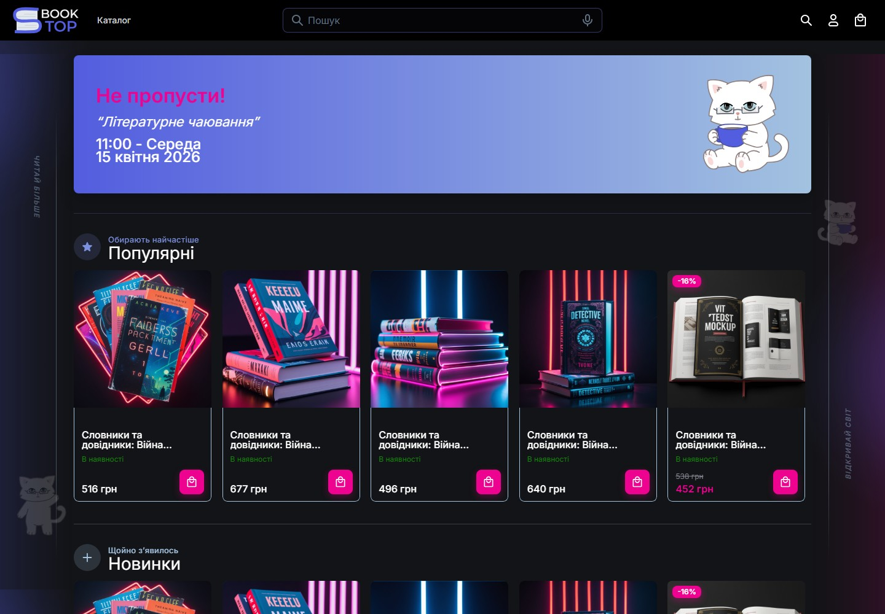
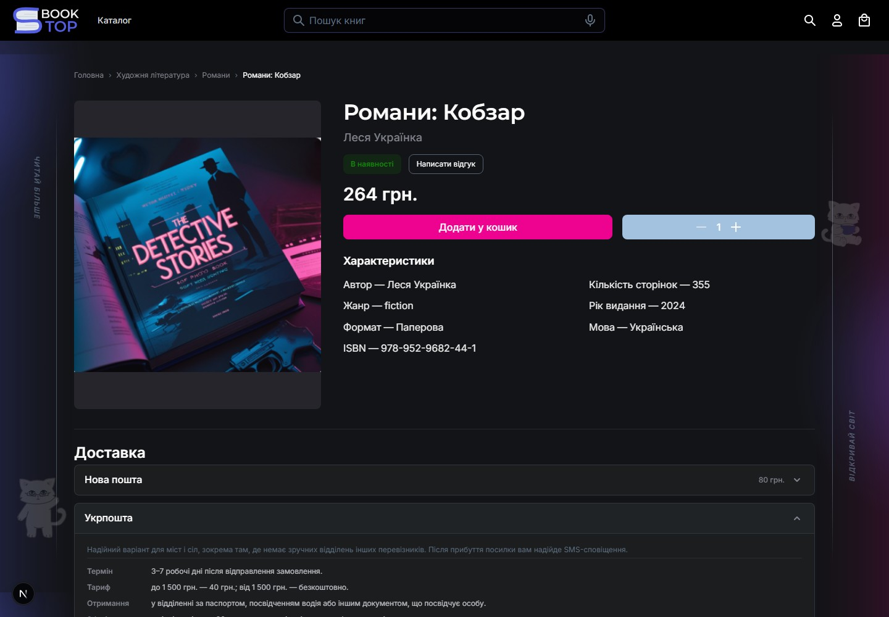
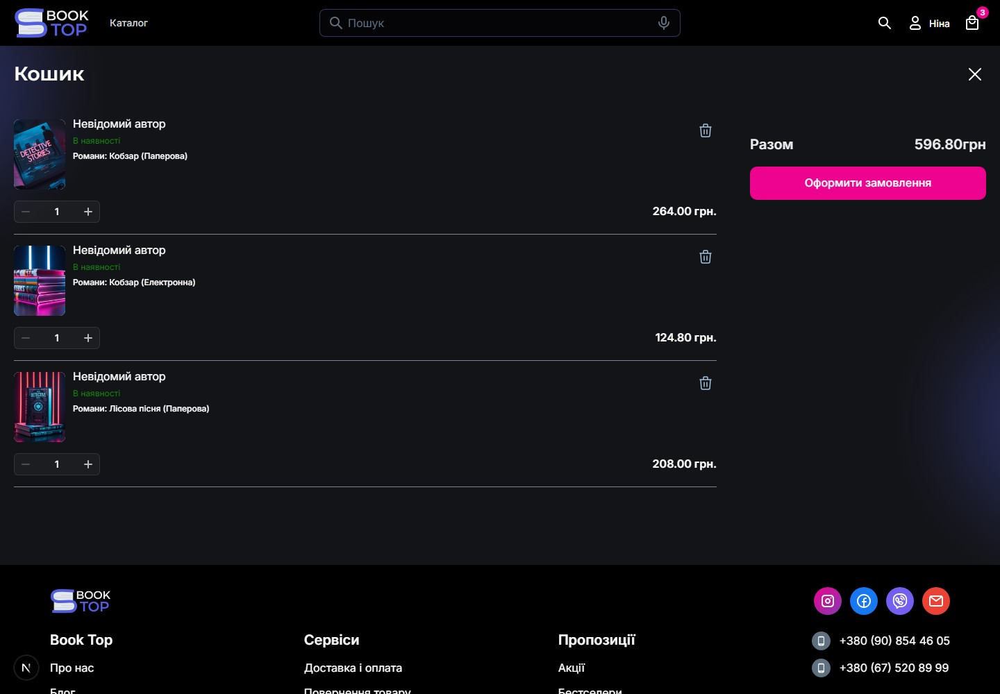
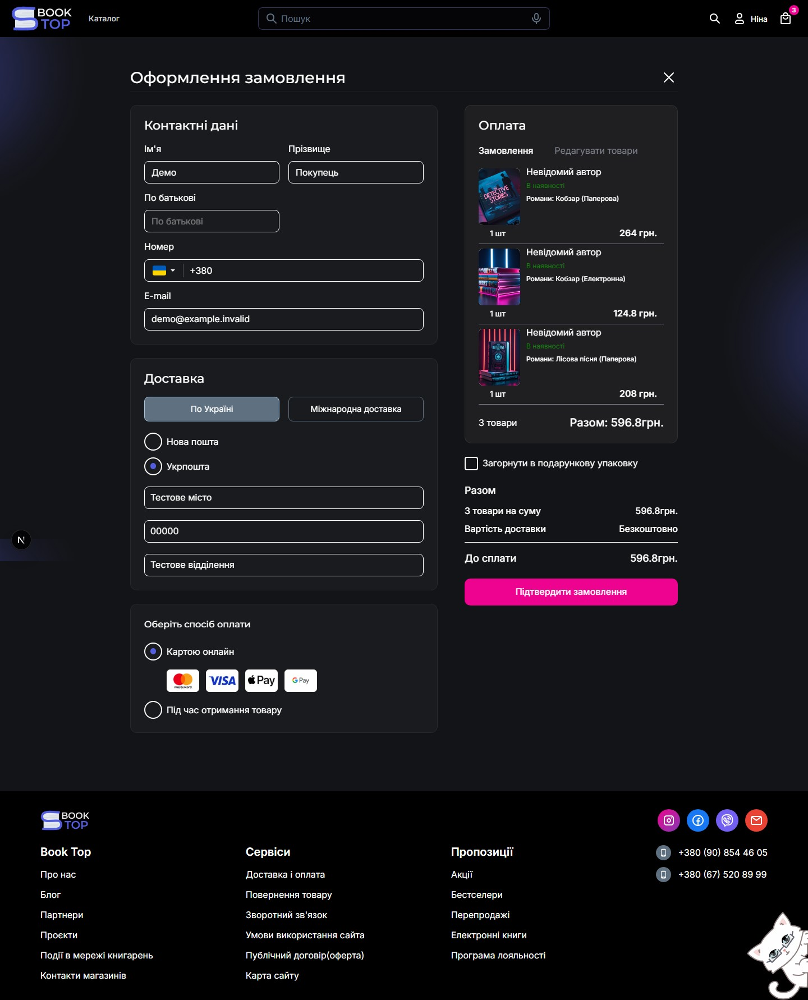

# Booktop Marketplace

Booktop is a full-stack marketplace application with a book-focused storefront and a multi-layer .NET API. It brings together public catalog browsing, account flows, company operations, and the infrastructure needed to run the application locally.

## Project context and contribution

This was my diploma project at IT Step Academy, a private IT academy. My contribution focused on frontend development. I worked in a five-person, cross-functional team: one frontend developer (me), one backend developer, two designers, and one DevOps engineer. The project gave me experience coordinating work across frontend, backend, design, and DevOps.

## Screenshots

These screenshots were captured from the running application with its development seed data.

| Storefront | Catalog and filters |
| --- | --- |
|  |  |

### Сторінка товару



### Кошик



### Оформлення замовлення та оплата



## What it includes

- Browse products and categories; search and filter by catalog attributes, price, and availability.
- Product detail pages, similar-product suggestions, and curated new, popular, and on-sale lists.
- Account and company workflows exposed through the web client and API, including product, order, inventory, and review operations.
- An ASP.NET Core API organized into Domain, Application, Infrastructure, and API projects.
- PostgreSQL persistence, Redis caching, background jobs, and optional search, object-storage, telemetry, and external-provider integrations.

The screenshots show a local development environment with synthetic seed data. There is no verified public demo URL.

## Technology

| Area | Technologies |
| --- | --- |
| Web | Next.js 16, React 19, TypeScript |
| API | .NET 10, ASP.NET Core, MediatR, FluentValidation |
| Persistence and cache | PostgreSQL, EF Core, Redis |
| Background work and media | Hangfire; MinIO or S3-compatible storage configuration |
| Optional services | Elasticsearch, ClickHouse, OpenTelemetry, OAuth, email, Telegram and shipping/payment integrations |
| Verification | xUnit, Vitest, Playwright |
| Local infrastructure | Docker Compose |

## Architecture

The API keeps HTTP concerns at the edge, dispatches use cases through MediatR, and keeps persistence and external-service implementations in Infrastructure. See the [architecture guide](docs/architecture.md) for the component diagram and request flow. The repository also contains a more detailed [backend layer and request-flow note](backend/ARCHITECTURE_AND_REQUEST_FLOW.md).

## Run locally with Docker Compose

Prerequisites: Docker Desktop (or Docker Engine with Compose), Node.js for local frontend commands, and .NET SDK 10.0.202 if running backend commands outside Docker. The backend pins its SDK in `global.json`.

From the repository root, create local environment files from the checked-in examples:

```powershell
Copy-Item backend/.env.example backend/.env
Copy-Item frontend/.env.example frontend/.env
```

Then start the development stack, including the optional frontend Compose profile:

```powershell
docker compose --profile frontend up -d --build
```

The Compose configuration exposes the frontend at `http://localhost:3000`, the API at `http://localhost:8080`, PostgreSQL at `localhost:5432`, and Redis at `localhost:6379`. API documentation is available at `/swagger` and `/scalar` when the API is running in Development. Compose also starts MinIO for local object storage.

Stop the stack with:

```powershell
docker compose --profile frontend down
```

The Compose setup is the repository's intended development workflow. A full, unmodified Compose startup could not be verified in this environment because the configured `minio/minio:latest` image could not be pulled. The API, PostgreSQL, and Redis were started separately in an isolated local Compose project for the checks and screenshots in this README.

### Configuration

- `backend/.env.example` documents backend settings and local defaults. Replace the development JWT secret before any non-local use.
- `frontend/.env.example` sets `NEXT_PUBLIC_API_URL`; use the API address reachable from the browser.
- OAuth, email, Telegram, payment, shipping, web-push, and cloud-storage credentials are needed only for the corresponding integrations. Do not commit `.env` files or put secrets in `NEXT_PUBLIC_` variables.
- `backend/scripts/seed-test-data.sql` contains destructive SQL. Review it before using it; the API also has development startup seeders.

## Tests and checks

Frontend commands, from `frontend/`:

```powershell
npm ci
npx vitest run
npm run lint
npm run build
```

Browser tests are available through `npm run test:e2e`; they require the frontend, API, and a configured browser environment.

Backend unit tests, from `backend/`:

```powershell
dotnet test tests/Marketplace.Tests.Unit/Marketplace.Tests.Unit.csproj --configuration Release
```

The solution also contains integration, container-integration, and E2E test projects. Their infrastructure requirements are described in [backend test notes](backend/tests/README.md).

## Repository map

```text
frontend/                         Next.js storefront and client applications
backend/src/Marketplace.API/      HTTP API, controllers, middleware, API docs
backend/src/Marketplace.Application/  Use cases, validation, DTOs and ports
backend/src/Marketplace.Domain/   Domain model and repository contracts
backend/src/Marketplace.Infrastructure/ Persistence and external-service adapters
backend/tests/                    Unit, integration, container and E2E projects
docs/                             Platform, domain and portfolio documentation
```

## Technical highlights

- The API separates domain rules, application use cases, HTTP endpoints, and infrastructure adapters.
- MediatR handlers and FluentValidation provide a consistent path for many API use cases.
- Catalog search supports Elasticsearch with database fallback paths in the catalog query handlers.
- Inventory availability is aggregated for storefront responses, while Redis is used for selected read caches.
- The codebase includes automated unit, integration, container, browser, and presentation-oriented test workflows.

## Project status and limits

- The screenshots and local API checks use development seed data; they do not establish production readiness or a live deployment.
- Third-party flows need valid provider credentials and configuration.
- Some optional infrastructure is only needed when its feature is enabled.
- The repository has no `LICENSE` file, so its reuse terms are not stated.
- Readiness reports in `reports/` are dated documents and should be read in their historical context.
