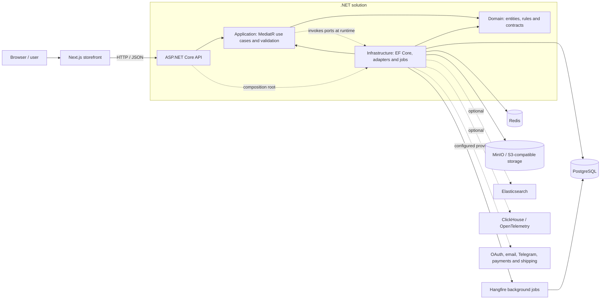

# Architecture

Booktop is split into a Next.js web client and a .NET API. Docker Compose supplies the local API dependencies. The optional services in the diagram are configured in the repository and can be enabled when their features are needed.

## Components

The diagram combines the request path, project dependencies, and runtime calls through ports. Dotted arrows mark composition, port calls, and optional or configuration-dependent integrations. The dependency direction in code keeps Domain independent, lets Application depend on Domain, and places concrete infrastructure implementations behind application/domain contracts. The API composes these projects through dependency injection.

## Request flow

1. The browser sends an HTTP request to an API controller.
2. Middleware and model binding handle cross-cutting HTTP concerns and request validation.
3. The controller dispatches a command or query through MediatR (some simple read paths call application services directly).
4. Application handlers validate and coordinate the use case through domain contracts and ports.
5. Infrastructure adapters use EF Core/PostgreSQL, Redis, or configured external services.
6. The API maps the result to an HTTP response; scheduled work is handled through Hangfire where applicable.

For a code-level description of the backend layers and an authentication sequence example, see [ARCHITECTURE_AND_REQUEST_FLOW.md](../backend/ARCHITECTURE_AND_REQUEST_FLOW.md). The API's endpoint documentation is under `backend/src/Marketplace.API/Docs/Endpoints/`.
